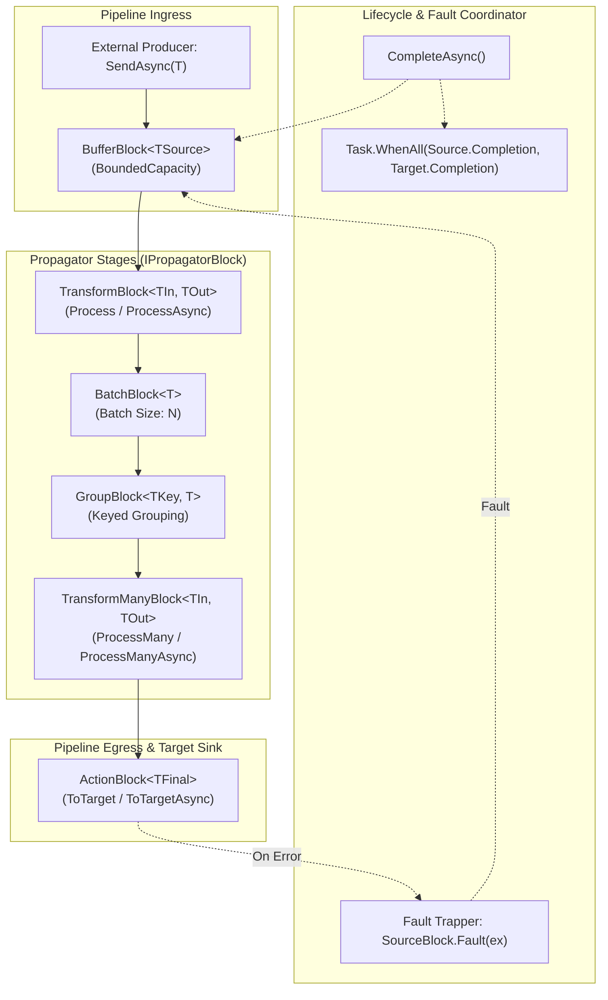

# DataflowBuilder Architecture

This document describes the design principles, core abstractions, and runtime mechanics of **DataflowBuilder**.

---

## 1. Architectural Overview & Design Principles

DataflowBuilder is engineered around five fundamental principles:

1. **Declarative Fluent Composition**: Pipelines are assembled fluently where each chained step represents a discrete dataflow stage.
2. **Compile-Time Type Safety & State Enforcing**: Using phantom type parameters on fluent builders (`IFluentBuilder<TExtension, TContext>`), the compiler prevents invalid operations (such as chaining transformations after a terminal sink, or calling `.Build()` before a target block is attached).
3. **Controlled Backpressure & Zero-Leak Memory Bounds**: Every stage defaults to bounded queues (`BoundedCapacity`), ensuring that fast producers do not exhaust memory when feeding slower downstream consumers.
4. **Independent Stage Concurrency**: Each block can specify its own `maxDegreeOfParallelism`, enabling CPU-heavy or I/O-intensive stages to scale concurrency independently without impacting neighboring stages.
5. **Robust Fault Isolation & Error Propagation**: Uncaught exceptions in processing delegates are trapped immediately, causing the pipeline's ingress block to fault and propagating the error cleanly to the completion awaiter.

---

## 2. Component & Flow Architecture



---

## 3. Core Abstractions & Interfaces

### Fluent Builder Abstractions

```csharp
namespace DotnetKit.DataflowBuilder.Abstractions;

public interface IFluentBuilder<out TContext>
{
    TContext Current { get; }
}

public interface IFluentBuilder<in TExtension, out TContext>
{
    TContext Current { get; }
}
```

- `TExtension`: Marker type representing the current capability or block type (e.g. `ISourceBlock<TOutput>` or `ITargetBlock<TInput>`).
- `TContext`: The underlying pipeline builder context (`IPipelineBuilder<TSource>`).

### Pipeline Builder Interfaces

```csharp
public interface IPipelineBuilder<TSource> : IPipelineBuilder
{
    ISourceBlock<TSource> SourceBlock { get; }
    IPipeline<TSource> Build();
}

public interface IPipelineBuilder
{
    CancellationToken CancellationToken { get; }
    void AddPropagatorBlock<TInput, TOutput>(IPropagatorBlock<TInput, TOutput> propagatorBlock);
    void AddTargetBlock<TInput>(ITargetBlock<TInput> targetBlock);
    // Block factory methods...
}
```

### Executable Pipeline Interfaces

```csharp
public interface IPipeline<TSource>
{
    Task CompleteAsync();
    Task SendAsync(TSource dataItem, CancellationToken cancellationToken = default);
}

public interface IPipeline<TSource1, TSource2> : IPipeline<Tuple<TSource1, TSource2>>
{
    Task Send1Async(TSource1 dataItem, CancellationToken cancellationToken = default);
    Task Send2Async(TSource2 dataItem, CancellationToken cancellationToken = default);
}
```

---

## 4. Block Topology & TPL Dataflow Mapping

DataflowBuilder maps high-level builder methods directly to optimized TPL Dataflow primitives:

| DataflowBuilder API | Underlying TPL Dataflow Block | Description |
| :--- | :--- | :--- |
| `FromSource<T>(size)` | `BufferBlock<T>` | Entry FIFO queue providing bounded buffer and backpressure. |
| `FromSources<T1, T2>(size)` | `JoinBlock<T1, T2>` | Ingests from two inputs and joins paired elements into a `Tuple<T1, T2>`. |
| `Process(func)` | `TransformBlock<TIn, TOut>` | Synchronous 1-to-1 data transformation. |
| `ProcessAsync(asyncFunc)` | `TransformBlock<TIn, TOut>` | Asynchronous 1-to-1 data transformation with task unwrapping. |
| `ProcessMany(func)` | `TransformManyBlock<TIn, TOut>` | Synchronous 1-to-N element projection (expansion/flattening). |
| `ProcessManyAsync(asyncFunc)`| `TransformManyBlock<TIn, TOut>` | Asynchronous 1-to-N element projection. |
| `Batch(size)` | `BatchBlock<T>` | Groups N incoming items into fixed-size arrays `T[]`. |
| `Group(selector, size)` | `GroupBlock<TKey, T>` (Custom) | Key-based grouped batching. |
| `ToTarget(action)` | `ActionBlock<T>` | Synchronous consumer terminating the pipeline. |
| `ToTargetAsync(asyncAction)` | `ActionBlock<T>` | Asynchronous consumer terminating the pipeline. |

---

## 5. Pipeline Lifecycle & Execution Mechanics

### 1. Assembly
Blocks are instantiated via factory methods on `IPipelineBuilder`. Each block is configured with its designated `BoundedCapacity`, `MaxDegreeOfParallelism`, and `CancellationToken`.

### 2. Linking with Completion Propagation
When blocks are appended via `AddPropagatorBlock` or `AddTargetBlock`, they are linked with:

```csharp
sourceBlock.LinkTo(targetBlock, new DataflowLinkOptions
{
    PropagateCompletion = true
});
```

This guarantees that when an upstream block finishes processing all remaining messages, it automatically signals completion to its successor.

### 3. Ingestion & Backpressure
Producers invoke `await pipeline.SendAsync(item)`. If the ingress `BufferBlock` is at capacity, `SendAsync` yields asynchronously, preventing uncontrolled heap growth.

### 4. Teardown
Calling `await pipeline.CompleteAsync()`:
1. Calls `_sourceBlock.Complete()` to prevent further messages from entering.
2. The completion ripples sequentially through each linked block.
3. The method returns `Task.WhenAll(_sourceBlock.Completion, _destinationBlock.Completion)`, ensuring that the caller only resumes when all in-flight items have been completely drained and finalized.

---

## 6. Concurrency & Parallelism Model

Each block functions as an autonomous worker pool:
- Operations run on the .NET `ThreadPool` without affinity to the caller's thread.
- If `maxDegreeOfParallelism = 1`, in-order processing is preserved within that stage.
- If `maxDegreeOfParallelism > 1`, items are processed concurrently, and completion ordering depends on individual task durations.

---

## 7. Fault Tolerance Architecture

When an unhandled exception occurs inside a stage delegate:

```csharp
try
{
    await asyncAction(input);
}
catch (Exception ex)
{
    if (!SourceBlock.Completion.IsCompleted)
    {
        SourceBlock.Fault(ex);
    }
    throw;
}
```

1. The catch handler calls `SourceBlock.Fault(ex)`, forcing the entry block into a faulted state.
2. The exception is re-thrown to fault the local block.
3. As a result, in-flight processing halts gracefully, and any attempt to send new items fails immediately.
4. Calling `await pipeline.CompleteAsync()` unwraps the exception and surfaces it to the supervising caller.

---

## 8. Multi-Source Pipeline Mechanics

```mermaid
sequenceDiagram
    autonumber
    participant App as Application
    participant B1 as SourceBuffer 1
    participant B2 as SourceBuffer 2
    participant Join as JoinBlock&lt;T1, T2&gt;
    participant Pipeline as Downstream Stages

    App->>B1: Send1Async(itemA)
    App->>B2: Send2Async(item1)
    B1->>Join: Target1.OfferMessage(itemA)
    B2->>Join: Target2.OfferMessage(item1)
    Note over Join: Greedy Join pairs itemA and item1
    Join->>Pipeline: Output Tuple(itemA, item1)
```

- Ingress is managed via two independent `BufferBlock` instances.
- Both buffers are linked to `JoinBlock.Target1` and `JoinBlock.Target2` with `PropagateCompletion = true`.
- Completing the multi-source pipeline signals completion to both targets and the join block simultaneously.
