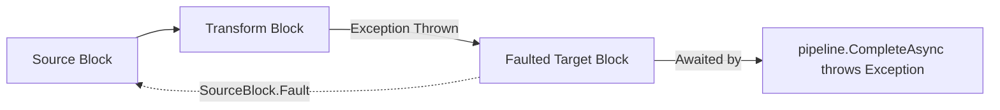

# Error Handling & Fault Tolerance

In asynchronous streaming pipelines, handling runtime exceptions gracefully without losing context or leaving orphaned background tasks is vital. DataflowBuilder integrates fault-isolation and cancellation throughout the pipeline lifecycle.

---

## 1. Exception Trapping & Pipeline Faulting

In DataflowBuilder:
- Every action and transformation block wraps user delegates in safe error-trapping handlers (`HandleAsyncAction`, `HandleAsyncFunction`, and try/catch blocks).
- If an exception is thrown inside a transformation or target delegate:
  1. The exception is intercepted.
  2. The pipeline's ingress block (`SourceBlock`) is immediately notified and marked faulted via `SourceBlock.Fault(exception)`.
  3. The current block is faulted, halting further item consumption.
  4. The error propagates to the pipeline's completion task.



---

## 2. Catching Errors on Completion

When an exception occurs inside a stage, `pipeline.CompleteAsync()` will re-throw the faulting exception:

```csharp
var pipeline = DataFlowPipelineBuilder.FromSource<int>()
    .Process(value =>
    {
        if (value == 0)
        {
            throw new InvalidOperationException("Division by zero error!");
        }
        return 100 / value;
    })
    .ToTarget(result => Console.WriteLine(result))
    .Build();

try
{
    await pipeline.SendAsync(10);
    await pipeline.SendAsync(0); // Triggers fault
    await pipeline.SendAsync(5);

    await pipeline.CompleteAsync();
}
catch (InvalidOperationException ex)
{
    Console.Error.WriteLine($"Pipeline failed cleanly: {ex.Message}");
}
```

---

## 3. Cooperative Cancellation with `CancellationToken`

Pipelines can be bound to a `CancellationToken` at initialization to support aborting long-running workflows:

```csharp
using var cts = new CancellationTokenSource(TimeSpan.FromSeconds(5));

var pipeline = DataFlowPipelineBuilder.FromSource<string>(cancellationToken: cts.Token)
    .ProcessAsync(async item =>
    {
        return await LongRunningService.ProcessAsync(item, cts.Token);
    })
    .ToTarget(item => Console.WriteLine(item))
    .Build();

try
{
    await pipeline.SendAsync("Record 1", cts.Token);
    await pipeline.CompleteAsync();
}
catch (OperationCanceledException)
{
    Console.WriteLine("Pipeline processing cancelled by token.");
}
```

When a cancellation token is canceled:
- Entry buffers cease accepting new messages.
- Active blocks cancel their in-flight tasks where cancellation tokens are passed.
- `CompleteAsync()` will resolve with an `OperationCanceledException` or `TaskCanceledException`.

---

## 4. Best Practices for Error Resilience

1. **Catch Transient Errors Locally**: If individual items can fail and should be retried or routed to a dead-letter queue, handle that exception *inside* the delegate rather than letting it fault the entire pipeline:

   ```csharp
   .ProcessAsync(async item =>
   {
       try
       {
           return await RemoteApi.SendAsync(item);
       }
       catch (HttpRequestException ex)
       {
           Logger.LogWarning(ex, "Failed item {Id}, routing to dead letter", item.Id);
           await DeadLetterQueue.PublishAsync(item);
           return null; // or fallback
       }
   })
   ```

2. **Always Call `CompleteAsync` in a `finally` block or ensure clean awaits**: This prevents hung buffers from holding system resources.
