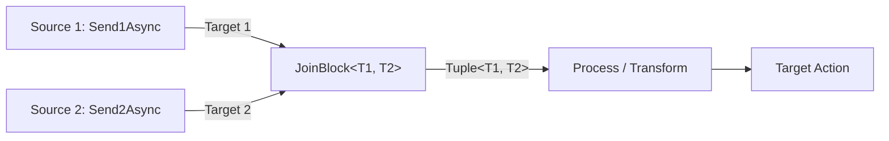

# Multi-Source Pipelines

DataflowBuilder provides native support for joining two asynchronous data streams using `FromSources<T1, T2>()`. This enables pairing records from disparate sources before pushing them through shared downstream transformation and sink steps.

---

## 1. How Joining Works

Multi-source pipelines utilize a `JoinBlock<T1, T2>` configured with `Greedy = true`. As items arrive on either input, they are buffered until a corresponding item is available on the alternate input, at which point a `Tuple<T1, T2>` is emitted downstream.



---

## 2. Defining and Building a Multi-Source Pipeline

To initiate a multi-source pipeline, call `DataFlowPipelineBuilder.FromSources<T1, T2>()`:

```csharp
using DotnetKit.DataflowBuilder;

var pipeline = DataFlowPipelineBuilder.FromSources<string, int>(sourceBufferSize: 50)
    .Process(pair =>
    {
        string text = pair.Item1;
        int count = pair.Item2;
        return $"{text} repeated {count} times: {string.Concat(Enumerable.Repeat(text, count))}";
    })
    .ToTarget(result =>
    {
        Console.WriteLine(result);
    })
    .Build();
```

---

## 3. Ingesting Data into Dual Sources

When using a multi-source pipeline, the builder produces an `IPipeline<T1, T2>` instance that provides `Send1Async` and `Send2Async`:

```csharp
// Push elements to the first stream
await pipeline.Send1Async("Alpha");
await pipeline.Send1Async("Beta");

// Push elements to the second stream
await pipeline.Send2Async(3);
await pipeline.Send2Async(2);

// Signal completion and await processing
await pipeline.CompleteAsync();
```

**Output:**
```text
Alpha repeated 3 times: AlphaAlphaAlpha
Beta repeated 2 times: BetaBeta
```

> [!IMPORTANT]
> Directly invoking `pipeline.SendAsync(Tuple<T1, T2>)` on a multi-source pipeline will throw a `NotSupportedException`. Always use `Send1Async` and `Send2Async` to feed the individual stream targets.

---

## 4. Asynchronous and Delayed Arrival

Items in a multi-source pipeline do not have to arrive synchronously. If one source is faster than the other, items will safely queue in the entry buffer up to `sourceBufferSize`:

```csharp
var pipeline = DataFlowPipelineBuilder.FromSources<SensorReading, CalibrationData>()
    .Process(pair =>
    {
        var reading = pair.Item1;
        var calibration = pair.Item2;
        return reading.ApplyOffset(calibration.OffsetFactor);
    })
    .ToTargetAsync(async calibratedReading =>
    {
        await TimeseriesStore.SaveAsync(calibratedReading);
    })
    .Build();

// Concurrently feed readings and calibration streams
var task1 = Task.Run(async () =>
{
    await foreach (var reading in ReadSensorsAsync())
    {
        await pipeline.Send1Async(reading);
    }
});

var task2 = Task.Run(async () =>
{
    await foreach (var calibration in ReadCalibrationAsync())
    {
        await pipeline.Send2Async(calibration);
    }
});

await Task.WhenAll(task1, task2);
await pipeline.CompleteAsync();
```

---

## 5. Teardown and Completion

Calling `await pipeline.CompleteAsync()` on a multi-source pipeline:

1. Signals completion to the first source (`Target1.Complete()`).
2. Signals completion to the second source (`Target2.Complete()`).
3. Signals completion to the enclosing join block.
4. Waits asynchronously for both the join block and all downstream destination blocks to finalize.
