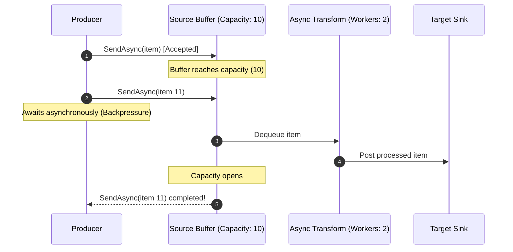

# Parallelism & Performance

DataflowBuilder is architected for high-throughput, low-latency, and zero-leak memory management under heavy streaming workloads. This guide outlines best practices for tuning concurrency, configuring buffers, and preventing bottlenecks.

---

## 1. Concurrency Model (`maxDegreeOfParallelism`)

Each block in DataflowBuilder accepts an optional `maxDegreeOfParallelism` argument (defaulting to 1). This setting controls how many tasks the block will execute concurrently:

```csharp
var pipeline = DataFlowPipelineBuilder.FromSource<HttpRequestPayload>(sourceBufferSize: 200)
    // CPU-bound parsing: Scale up to the number of logical processor cores
    .Process(payload => ParsePayload(payload), maxDegreeOfParallelism: Environment.ProcessorCount)

    // I/O-bound database enrichment: Scale higher for network I/O concurrency
    .ProcessAsync(async record => await Database.EnrichAsync(record), maxDegreeOfParallelism: 16)

    // Terminal persistence sink: Controlled concurrency to avoid overwhelming database connection pool
    .ToTargetAsync(async enrichedRecord => await Database.SaveAsync(enrichedRecord), maxDegreeOfParallelism: 4)
    .Build();
```

---

## 2. Decoupled Thread Execution

Because each block in a pipeline is executed independently on the .NET `ThreadPool`:

- Upstream blocks do not wait synchronously for downstream processing unless downstream queues fill up (backpressure).
- Slow stages do not block fast stages, provided sufficient buffer capacity exists between them.
- CPU-intensive tasks and asynchronous I/O operations naturally balance across available cores.

---

## 3. Backpressure & Memory Bounds

Unbounded queues in streaming applications can lead to memory exhaustion (`OutOfMemoryException`) if producers generate data faster than consumers can process it.

DataflowBuilder applies bounded capacities at every stage:

1. **Source Buffer**: Set via `sourceBufferSize` in `FromSource<T>(sourceBufferSize: 100)`. When the entry buffer fills, `await pipeline.SendAsync(item)` pauses the caller asynchronously until capacity is freed.
2. **Intermediate Blocks**: Each propagator automatically sets `BoundedCapacity = maxDegreeOfParallelism`, ensuring that intermediate queues do not grow unbounded.
3. **Batch Blocks**: Sets `BoundedCapacity = batchSize` so only full or active batches are buffered.



---

## 4. Tuning Guidelines: CPU vs I/O Bound

| Workload Type | Recommended Parallelism | Example Tasks |
| :--- | :--- | :--- |
| **CPU-Bound** | `Environment.ProcessorCount` | Image resizing, encryption/decryption, JSON deserialization, compression |
| **I/O-Bound** | `2 * ProcessorCount` to `16 * ProcessorCount` | HTTP REST API calls, database queries, Redis caching, blob storage uploads |
| **Batch Sinks** | `1` to `4` (with batch size 50 - 1000) | Bulk database inserts, Elasticsearch indexation, Kafka message batches |

---

## 5. Performance Best Practices

1. **Always Await `SendAsync`**: Never use `.GetAwaiter().GetResult()` or `.Wait()` on `SendAsync()`, as blocking on synchronous threads can cause thread pool starvation.
2. **Combine Batching with Parallelism**: For bulk data writes, place `.Batch(batchSize)` before `.ProcessAsync(..., maxDegreeOfParallelism: N)`.
3. **Favor Pure Functions**: Avoid mutating shared mutable state inside transformation delegates. Rely on immutable data models and pipeline stage outputs.
