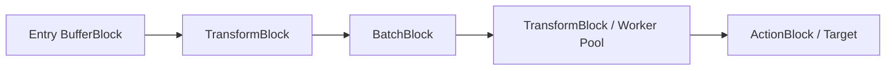

# Pipeline Concepts

DataflowBuilder acts as a high-level, type-safe orchestrator built on top of the .NET Task Parallel Library (TPL) Dataflow (`System.Threading.Tasks.Dataflow`). This document explores the architectural concepts and mechanics governing how data travels through a pipeline.

---

## 1. The Producer-Consumer Model

In classical multithreading, coordinating worker queues, lock contention, backpressure, and graceful shutdown requires extensive boilerplate. TPL Dataflow replaces this with actor-like message-passing blocks.

DataflowBuilder encapsulates this model into a linear or multi-source pipeline:



Each stage operates concurrently on its own schedule, receiving messages from upstream and pushing processed messages downstream.

---

## 2. Block Categories

DataflowBuilder divides blocks into three roles:

| Category | Underlying Block Type | Purpose | Methods |
| :--- | :--- | :--- | :--- |
| **Source Block** | `BufferBlock<T>` / `JoinBlock<T1, T2>` | Accepts external inputs into the pipeline with bounded queuing | `FromSource<T>()`, `FromSources<T1, T2>()` |
| **Propagator Block** | `TransformBlock<TIn, TOut>`, `TransformManyBlock<TIn, TOut>`, `BatchBlock<T>`, `GroupBlock<TKey, T>` | Transforms, filters, expands, batches, or groups intermediate items | `Process`, `ProcessAsync`, `ProcessMany`, `ProcessManyAsync`, `Batch`, `Group` |
| **Target Block** | `ActionBlock<T>` | Final consumer that terminates the pipeline | `ToTarget`, `ToTargetAsync` |

---

## 3. Fluent State Machine & Compile-Time Type Safety

DataflowBuilder uses the marker pattern via `IFluentBuilder<TExtension, TContext>` to enforce valid pipeline sequencing at compile time:

1. **At Source**: The builder exposes `ISourceBlock<TSource>`, allowing only intermediate operations or a terminal sink.
2. **Intermediate Stages**: Each `.Process(...)` or `.Batch(...)` returns an `IFluentBuilder<ISourceBlock<TNext>, ...>`.
3. **At Target**: Calling `.ToTarget(...)` changes the builder marker to `IFluentBuilder<ITargetBlock<TInput>, ...>`.
4. **Final Step**: The `.Build()` extension method is **only** accessible once the target block is specified. You cannot call `.Build()` midway or add further transformations after a terminal target.

```csharp
// Compile error: Cannot call Process after ToTarget
DataFlowPipelineBuilder.FromSource<int>()
    .ToTarget(Console.WriteLine)
    .Process(x => x * 2); // DOES NOT COMPILE

// Compile error: Cannot call Build without a Target
DataFlowPipelineBuilder.FromSource<int>()
    .Process(x => x * 2)
    .Build(); // DOES NOT COMPILE
```

---

## 4. Completion Propagation

When `CompleteAsync()` is called on an `IPipeline<T>`:

1. Completion is signaled to the pipeline's entry `BufferBlock`.
2. As messages drain from the buffer, the `DataflowLinkOptions.PropagateCompletion = true` link triggers completion on the next downstream block.
3. Each block finishes processing its remaining buffered items before signaling its successor.
4. When the terminal `ActionBlock` completes, `Task.WhenAll(source.Completion, target.Completion)` resolves, confirming all stages have safely emptied and closed.

---

## 5. Grouping Operations

In addition to standard fixed-size batching (`BatchBlock`), DataflowBuilder provides `GroupBlock<TGroupKey, TInput>`:

- Items are classified into buckets using a key selector: `Func<TInput, TGroupKey>`.
- When any individual bucket reaches its `boundedCapacity`, that specific bucket is immediately emitted downstream as an array `TInput[]`.
- Unfinished groups continue to accumulate until either subsequent items fill them or the pipeline shuts down.

```csharp
var pipeline = DataFlowPipelineBuilder.FromSource<SensorReading>()
    // Group readings by SensorId; emit batches whenever any sensor accumulates 10 readings
    .Group(reading => reading.SensorId, maxDegreeOfParallelism: 10)
    .ToTarget(batch =>
    {
        Console.WriteLine($"Sensor {batch[0].SensorId} emitted {batch.Length} readings");
    })
    .Build();
```
